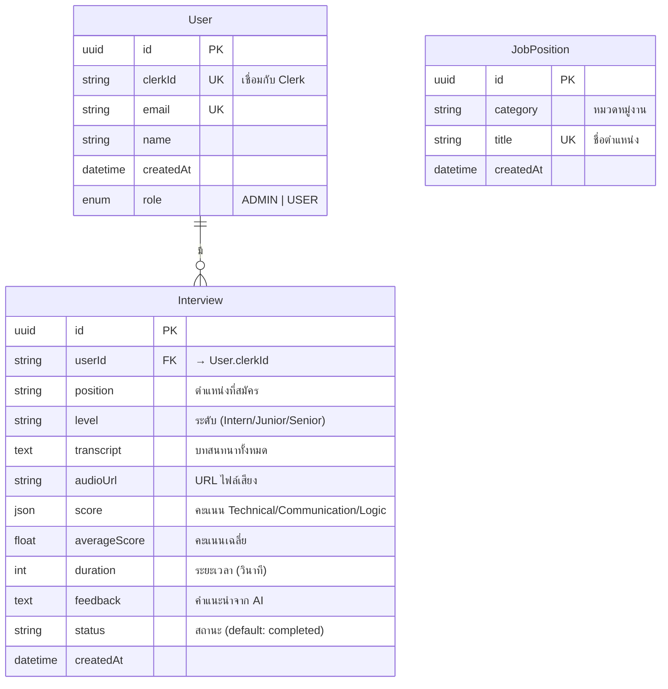
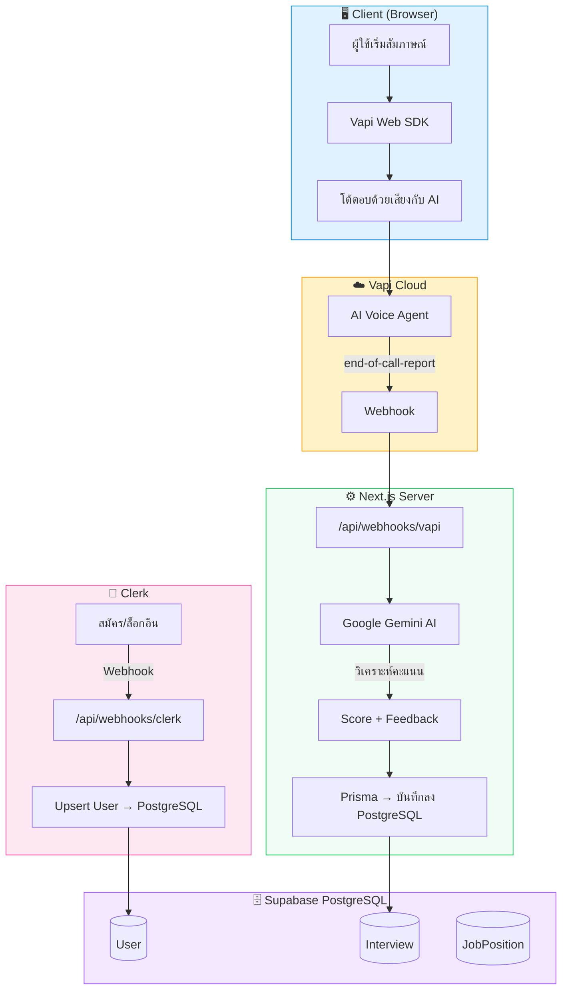

# 📖 คู่มือโปรเจกต์ AI Voice Interview

> **ระบบฝึกซ้อมสัมภาษณ์งานด้วย AI** — สัมภาษณ์โต้ตอบด้วยเสียง วิเคราะห์ผลอัตโนมัติ พร้อมแดชบอร์ดติดตามผล

---

## สารบัญ

1. [คู่มือการใช้งาน](#-คูมือการใชงาน)
2. [เครื่องมือที่ใช้พัฒนา](#-เครื่องมือที่ใชพัฒนา)
3. [โครงสร้างฐานข้อมูล](#-โครงสรางฐานขอมูล)

---

# 📘 คู่มือการใช้งาน

## 1. ภาพรวมของระบบ

AI Voice Interview คือแพลตฟอร์มฝึกซ้อมสัมภาษณ์งานที่ใช้ปัญญาประดิษฐ์ (AI) เป็นผู้สัมภาษณ์ โดยผู้ใช้สามารถ:

- **โต้ตอบด้วยเสียง** กับ AI ผู้สัมภาษณ์แบบเรียลไทม์
- **เลือกตำแหน่งงาน** และระดับที่ต้องการฝึกซ้อม (Intern / Junior / Mid Junior)
- **วาง Job Description** เพื่อให้ AI สร้างคำถามตรงจุด
- **รับคะแนนและคำแนะนำ** วิเคราะห์โดย Google Gemini AI
- **ติดตามพัฒนาการ** ผ่านแดชบอร์ดและประวัติสัมภาษณ์

---

## 2. ประเภทผู้ใช้งาน

| บทบาท | สิทธิ์การใช้งาน |
|--------|-----------------|
| **USER** (สมาชิกผู้ใช้งาน) | สมัครสมาชิก, ฝึกสัมภาษณ์, ดูแดชบอร์ดส่วนตัว, ดูประวัติ |
| **ADMIN** (ผู้ดูแลระบบ) | ดูข้อมูลผู้ใช้ทั้งหมด, ดูสถิติแพลตฟอร์ม, จัดการข้อมูล Analytics |

---

## 3. ขั้นตอนการใช้งาน (User Flow)

### 3.1 สมัครสมาชิก / เข้าสู่ระบบ

1. เข้าสู่หน้า Landing Page (`/`)
2. คลิก **"เริ่มพัฒนาตัวเองฟรี"** เพื่อสมัครสมาชิกใหม่ หรือ **"ลงชื่อเข้าใช้"** ถ้ามีบัญชีอยู่แล้ว
3. ระบบใช้ **Clerk** เป็นระบบยืนยันตัวตน รองรับ:
   - อีเมล / รหัสผ่าน
   - Social Login (Google, GitHub ฯลฯ)
4. เมื่อเข้าสู่ระบบสำเร็จ จะถูกนำทางไปหน้า **Dashboard** (`/dashboard`) โดยอัตโนมัติ

### 3.2 เริ่มฝึกสัมภาษณ์

1. จากหน้า Dashboard คลิกปุ่ม **"เริ่มสัมภาษณ์ใหม่"** (ไปยัง `/interview`)
2. ตั้งค่าการสัมภาษณ์:
   - **เลือกตำแหน่งงาน** — 5 หมวดหมู่รวม 36 ตำแหน่ง:
     - Software & Technology (12 ตำแหน่ง)
     - Design & UX/UI (6 ตำแหน่ง)
     - Marketing & Growth (6 ตำแหน่ง)
     - Business & Management (7 ตำแหน่ง)
     - Finance & Accounting (5 ตำแหน่ง)
   - **เลือกระดับ** — Intern / Junior / Mid Junior
   - **วาง Job Description** (ไม่บังคับ) — เพื่อให้ AI ออกแบบคำถามตรงกับตำแหน่งจริง
3. คลิกปุ่ม **"เริ่มพูดคุยตอนนี้"**
4. ระบบจะเชื่อมต่อกับ AI ผู้สัมภาษณ์ (ผ่าน Vapi):
   - **AI Interviewer Card** — แสดงสถานะ AI (กำลังพูด / เชื่อมต่อแล้ว)
   - **User Card** — แสดงสถานะไมโครโฟน (กำลังพูด / ปิดไมค์)
   - **ซับไทเทิล** — แสดง transcript แบบ real-time
   - **ตัวจับเวลา** — นับเวลาสัมภาษณ์ (นาที:วินาที)
5. ระหว่างสัมภาษณ์สามารถ:
   - **ปิด/เปิดไมค์** (Mute/Unmute)
   - **จบการสัมภาษณ์** โดยกดปุ่ม "จบการสัมภาษณ์"

### 3.3 การประมวลผลคะแนน (อัตโนมัติ)

เมื่อสิ้นสุดการสัมภาษณ์ ระบบทำงานเบื้องหลังดังนี้:
1. **Vapi** ส่ง Webhook (`end-of-call-report`) พร้อม transcript ทั้งหมด
2. ระบบส่ง transcript ไปให้ **Google Gemini AI** วิเคราะห์
3. Gemini ให้คะแนน 3 ด้าน (สเกล 1-10 แปลงเป็น 0-100):
   - **Technical** — ความรู้เชิงเทคนิค
   - **Communication** — การสื่อสาร
   - **Logic** — ความเป็นเหตุเป็นผล
4. คะแนนและ Feedback ถูกบันทึกลงฐานข้อมูลอัตโนมัติ

### 3.4 ดูแดชบอร์ดส่วนตัว (`/dashboard`)

แดชบอร์ดแสดงข้อมูลสำคัญ:

| ส่วน | รายละเอียด |
|------|-----------|
| **Welcome Banner** | คำทักทายตามเวลา + จำนวนสัมภาษณ์ที่ทำแล้ว |
| **สถิติภาพรวม** (4 การ์ด) | สัมภาษณ์ทั้งหมด, คะแนนเฉลี่ย, เวลาฝึกรวม, ระดับผู้ใช้ |
| **Feedback จาก AI** | คำแนะนำจากการสัมภาษณ์ล่าสุด |
| **Learning Activities** | กราฟแสดงกิจกรรมการฝึกซ้อมตลอดเวลา |
| **Radar Chart** | กราฟเรดาร์เปรียบเทียบคะแนนของแต่ละตำแหน่ง |
| **ตารางสัมภาษณ์ล่าสุด** | 5 รายการล่าสุดพร้อมลิงก์ดูรายละเอียด |

### 3.5 ดูประวัติสัมภาษณ์ (`/history`)

- แสดงประวัติสัมภาษณ์ทั้งหมดในรูปแบบตาราง
- ข้อมูลที่แสดง: ตำแหน่ง/ระดับ, วันที่ฝึก, ระยะเวลา, คะแนนรวม
- สามารถ **"ดูผลวิเคราะห์"** ของแต่ละครั้ง (`/history/[id]`) ซึ่งจะแสดง:
  - คะแนน 3 ด้าน (ตรรกะ / เทคนิค / การสื่อสาร)
  - บทสนทนาย้อนหลัง (Transcript)
  - คำแนะนำจาก AI (Feedback)
- สามารถ **ลบ** ประวัติสัมภาษณ์ที่ไม่ต้องการ

### 3.6 หน้าผู้ดูแลระบบ (Admin — `/admin`)

> เข้าถึงได้เฉพาะผู้ใช้ที่มี role = `ADMIN`

| เมนู | เส้นทาง | หน้าที่ |
|------|---------|--------|
| **แดชบอร์ด** | `/admin/dashboard` | กราฟภาพรวม: Timeline สัมภาษณ์, คะแนนเฉลี่ยตามตำแหน่ง, สัดส่วน Level |
| **Analytics** | `/admin/analytics` | สถิติเชิงลึกของแพลตฟอร์ม |
| **จัดการผู้ใช้** | `/admin/users` | ตารางรายชื่อสมาชิก (ชื่อ, อีเมล, สิทธิ์, วันสมัคร, จำนวนสัมภาษณ์) |
| **รายละเอียดผู้ใช้** | `/admin/users/[id]` | ดูข้อมูลเชิงลึกของผู้ใช้แต่ละคน |

---

## 4. โครงสร้างเส้นทาง (Routes) ของแอปพลิเคชัน

```
/                          → Landing Page (หน้าแนะนำ)
/sign-in                   → หน้าลงชื่อเข้าใช้
/sign-up                   → หน้าสมัครสมาชิก
/dashboard                 → แดชบอร์ดส่วนตัว
/interview                 → หน้าฝึกสัมภาษณ์
/history                   → ประวัติสัมภาษณ์ทั้งหมด
/history/[id]              → รายละเอียดผลสัมภาษณ์
/admin/dashboard           → แดชบอร์ดผู้ดูแลระบบ
/admin/analytics           → สถิติเชิงลึก
/admin/users               → จัดการผู้ใช้
/admin/users/[id]          → รายละเอียดผู้ใช้

── API Routes ──
/api/webhooks/clerk        → Webhook รับ event จาก Clerk (สร้าง/อัปเดตผู้ใช้)
/api/webhooks/vapi         → Webhook รับ event จาก Vapi (จบสัมภาษณ์ → วิเคราะห์คะแนน)
/api/deleteInterview       → API ลบประวัติสัมภาษณ์
/api/getUsers              → API ดึงข้อมูลผู้ใช้
/api/positions             → API ดึงรายการตำแหน่งงาน
/api/summary/countInterviews → API นับจำนวนสัมภาษณ์
/api/summary/countUsers    → API นับจำนวนผู้ใช้
```

---

# 🛠 เครื่องมือที่ใช้พัฒนา

## 1. Technology Stack

### Frontend Framework

| เครื่องมือ | เวอร์ชัน | หน้าที่ |
|-----------|---------|--------|
| **Next.js** | 16.1.6 | Full-stack React Framework (App Router) |
| **React** | 19.2.3 | UI Library |
| **TypeScript** | ^5 | ภาษาหลักในการพัฒนา (Type Safety) |

### Styling & UI

| เครื่องมือ | เวอร์ชัน | หน้าที่ |
|-----------|---------|--------|
| **TailwindCSS** | ^4.2.2 | Utility-first CSS Framework |
| **shadcn/ui** | ^4.1.0 | Component Library (Button, Card, Badge, Table ฯลฯ) |
| **Radix UI** | ^1.4.3 | Headless UI Primitives |
| **Lucide React** | ^1.0.1 | Icon Library |
| **React Icons** | ^5.6.0 | ไอคอนเพิ่มเติม |
| **Recharts** | ^3.8.1 | กราฟและแผนภูมิ (Radar Chart, Line Chart, Pie Chart) |
| **class-variance-authority** | ^0.7.1 | จัดการ variant ของ component |
| **clsx** + **tailwind-merge** | ^2.1.1 / ^3.5.0 | จัดการ className แบบ conditional |
| **tw-animate-css** | ^1.4.0 | CSS Animation utilities |

### Fonts

| ฟอนต์ | การใช้งาน |
|-------|----------|
| **Poppins** (500, 600) | ฟอนต์หลักของ body |
| **Geist** | ฟอนต์ sans-serif สำรอง |
| **IBM Plex Sans Thai** (300, 400, 600, 700) | ฟอนต์ภาษาไทยสำหรับ Landing Page |

### Authentication & User Management

| เครื่องมือ | เวอร์ชัน | หน้าที่ |
|-----------|---------|--------|
| **Clerk** | ^7.0.6 | ระบบ Authentication (สมัคร/ล็อกอิน/Social Login) |
| **Svix** | ^1.89.0 | ตรวจสอบ Webhook Signature จาก Clerk |

### AI & Voice

| เครื่องมือ | เวอร์ชัน | หน้าที่ |
|-----------|---------|--------|
| **Vapi AI** (`@vapi-ai/web`) | ^2.5.2 | ระบบสนทนาด้วยเสียง AI (Voice Agent) |
| **Google Generative AI** (`@google/genai`) | ^1.46.0 | วิเคราะห์ผลสัมภาษณ์โดย Gemini (model: `gemini-3.1-flash-lite`) |

### Database & ORM

| เครื่องมือ | เวอร์ชัน | หน้าที่ |
|-----------|---------|--------|
| **Prisma** (ORM) | ^7.5.0 | จัดการฐานข้อมูล PostgreSQL |
| **@prisma/adapter-pg** | ^7.5.0 | PostgreSQL Adapter สำหรับ Prisma |
| **pg** (node-postgres) | ^8.20.0 | PostgreSQL Client |
| **Supabase** (Hosted DB) | — | Cloud PostgreSQL Database (AWS ap-south-1) |

### Utilities

| เครื่องมือ | เวอร์ชัน | หน้าที่ |
|-----------|---------|--------|
| **Axios** | ^1.13.6 | HTTP Client สำหรับเรียก API |
| **dotenv** | ^17.3.1 | จัดการ Environment Variables |
| **Sonner** | ^2.0.7 | Toast Notification |

### Development Tools

| เครื่องมือ | เวอร์ชัน | หน้าที่ |
|-----------|---------|--------|
| **ESLint** | ^9 | ตรวจสอบคุณภาพโค้ด |
| **eslint-config-next** | 16.1.6 | กฎ ESLint สำหรับ Next.js |
| **PostCSS** | ^8.5.8 | CSS Preprocessor |
| **@tailwindcss/postcss** | ^4.2.2 | TailwindCSS PostCSS Plugin |

---

## 2. Environment Variables

| ตัวแปร | คำอธิบาย |
|--------|----------|
| `NEXT_PUBLIC_CLERK_PUBLISHABLE_KEY` | Clerk Public Key (ใช้ฝั่ง client) |
| `CLERK_SECRET_KEY` | Clerk Secret Key (ใช้ฝั่ง server) |
| `CLERK_WEBHOOK_SECRET` | Secret สำหรับตรวจสอบ Webhook จาก Clerk |
| `GEMINI_API_KEY` | API Key ของ Google Gemini AI |
| `NEXT_PUBLIC_VAPI_PUBLIC_KEY` | Vapi Public Key (ใช้ฝั่ง client) |
| `NEXT_PUBLIC_VAPI_ASSISTANT_ID` | ID ของ AI Assistant บน Vapi |
| `NEXT_PUBLIC_CLERK_SIGN_IN_URL` | เส้นทางหน้าล็อกอิน |
| `NEXT_PUBLIC_CLERK_SIGN_IN_FALLBACK_REDIRECT_URL` | หน้า redirect หลังล็อกอิน |
| `NEXT_PUBLIC_CLERK_SIGN_UP_FALLBACK_REDIRECT_URL` | หน้า redirect หลังสมัคร |
| `NEXT_PUBLIC_CLERK_AFTER_SIGN_OUT_URL` | หน้า redirect หลังล็อกเอาท์ |
| `DATABASE_URL` | Connection String ของ PostgreSQL (Supabase) |

---

## 3. โครงสร้างไฟล์โปรเจกต์

```
ai_voice_interview/
├── app/
│   ├── page.tsx                         # Landing Page
│   ├── layout.tsx                       # Root Layout (Clerk, Fonts, Navbar, Footer)
│   ├── globals.css                      # Global Styles + Design Tokens
│   ├── (Autentication)/                 # กลุ่ม Auth Routes
│   │   ├── layout.tsx
│   │   ├── sign-in/                     # หน้าล็อกอิน
│   │   └── sign-up/                     # หน้าสมัครสมาชิก
│   ├── dashboard/
│   │   ├── page.tsx                     # แดชบอร์ดผู้ใช้
│   │   └── components_dashboard/        # Sub-components (StatsCard, Chart, FeedBack ฯ)
│   ├── interview/
│   │   └── page.tsx                     # หน้าฝึกสัมภาษณ์ (Vapi Integration)
│   ├── history/
│   │   ├── page.tsx                     # ตารางประวัติสัมภาษณ์
│   │   ├── DeleteButton.tsx             # ปุ่มลบ (Client Component)
│   │   └── [id]/page.tsx               # รายละเอียดผลสัมภาษณ์
│   ├── admin/
│   │   ├── layout.tsx                   # Admin Layout + Sidebar
│   │   ├── AdminSidebar.tsx             # เมนูด้านข้างจัดการ
│   │   ├── dashboard/
│   │   │   ├── page.tsx                 # แดชบอร์ด Admin (Aggregation)
│   │   │   └── AdminGraphsView.tsx      # กราฟ Timeline, Topic, Level
│   │   ├── analytics/page.tsx           # สถิติเชิงลึก
│   │   └── users/
│   │       ├── page.tsx                 # ตารางรายชื่อผู้ใช้
│   │       └── [id]/page.tsx           # รายละเอียดผู้ใช้แต่ละคน
│   └── api/
│       ├── webhooks/
│       │   ├── clerk/route.ts           # Clerk Webhook (สร้าง/อัปเดต User ใน DB)
│       │   └── vapi/route.ts            # Vapi Webhook (วิเคราะห์คะแนน + บันทึก DB)
│       ├── deleteInterview/             # API ลบสัมภาษณ์
│       ├── getUsers/                    # API ดึงข้อมูลผู้ใช้
│       ├── positions/                   # API ดึงตำแหน่งงาน
│       └── summary/
│           ├── countInterviews/         # API นับสัมภาษณ์
│           └── countUsers/              # API นับผู้ใช้
├── components/
│   ├── Navbar.tsx                       # แถบนำทาง
│   ├── NavbarWrapper.tsx                # Wrapper ควบคุมการแสดง Navbar
│   ├── Footer.tsx                       # ส่วนท้ายเว็บ
│   ├── Logo.tsx                         # โลโก้
│   ├── Forbidden403.tsx                 # หน้า 403 Forbidden
│   ├── TermsModal.tsx                   # Modal ข้อกำหนดการใช้งาน
│   └── ui/                             # shadcn/ui Components (Button, Card, Badge ฯ)
├── lib/
│   ├── prisma.ts                        # Prisma Client Instance
│   ├── utils.ts                         # cn() utility (clsx + tailwind-merge)
│   ├── jobPositions.ts                  # Job Categories & Positions Data
│   ├── getlevelInfo.ts                  # คำนวณระดับผู้ใช้ (Level System)
│   ├── formatTime.ts                    # แปลงเวลาเป็น นาที:วินาที
│   ├── performanceData.ts               # ข้อมูล Performance
│   ├── seed.ts                          # Script สำหรับ Seed ข้อมูลเริ่มต้น
│   ├── generated/prisma/               # Prisma Generated Client
│   └── mockData/                        # ข้อมูลจำลอง
├── prisma/
│   └── schema.prisma                    # Prisma Schema (Models + Relations)
├── public/                              # Static Files
├── scripts/                             # Build/Deploy Scripts
├── .env                                 # Environment Variables
├── package.json                         # Dependencies
├── tsconfig.json                        # TypeScript Config
├── next.config.ts                       # Next.js Config
├── postcss.config.mjs                   # PostCSS Config
└── eslint.config.mjs                    # ESLint Config
```

---

## 4. วิธีติดตั้งและรันโปรเจกต์

```bash
# 1. Clone โปรเจกต์
git clone <repository-url>
cd ai_voice_interview

# 2. ติดตั้ง Dependencies
npm install

# 3. ตั้งค่า Environment Variables
# สร้างไฟล์ .env และกำหนดค่าตัวแปรตามที่ระบุในหัวข้อ Environment Variables

# 4. สร้าง Prisma Client
npx prisma generate

# 5. รันโปรเจกต์ (Development Mode)
npm run dev

# 6. เปิดเบราว์เซอร์ไปที่ http://localhost:3000
```

---

# 🗄 โครงสร้างฐานข้อมูล

## 1. ภาพรวม

- **Database Engine:** PostgreSQL
- **Hosting:** Supabase (AWS ap-south-1 Region)
- **ORM:** Prisma ^7.5.0 (พร้อม `@prisma/adapter-pg`)
- **Connection:** PgBouncer (Connection Pooling)

---

## 2. Entity Relationship Diagram (ERD)



---

## 3. รายละเอียดแต่ละตาราง

### 3.1 ตาราง `User` — ข้อมูลผู้ใช้

| คอลัมน์ | ชนิดข้อมูล | คุณสมบัติ | คำอธิบาย |
|---------|-----------|----------|----------|
| `id` | `String (UUID)` | `@id @default(uuid())` | Primary Key — รหัสผู้ใช้ |
| `clerkId` | `String` | `@unique` | รหัสจาก Clerk Authentication |
| `email` | `String` | `@unique` | อีเมลผู้ใช้ (ไม่ซ้ำกัน) |
| `name` | `String` | — | ชื่อ-นามสกุลผู้ใช้ |
| `role` | `Enum (Role)` | `@default(USER)` | บทบาท: `ADMIN` หรือ `USER` |
| `createdAt` | `DateTime` | `@default(now())` | วันเวลาที่สร้างบัญชี |

**ความสัมพันธ์:**
- `User` → `Interview[]` (1-to-Many: ผู้ใช้ 1 คนมีได้หลายสัมภาษณ์)

---

### 3.2 ตาราง `Interview` — ข้อมูลการสัมภาษณ์

| คอลัมน์ | ชนิดข้อมูล | คุณสมบัติ | คำอธิบาย |
|---------|-----------|----------|----------|
| `id` | `String (UUID)` | `@id @default(uuid())` | Primary Key — รหัสสัมภาษณ์ |
| `userId` | `String` | `FK → User.clerkId` | รหัสผู้ใช้ (Foreign Key เชื่อมไป `User.clerkId`) |
| `position` | `String` | — | ตำแหน่งงานที่สัมภาษณ์ เช่น "Software Engineer" |
| `level` | `String` | — | ระดับ เช่น "Junior", "Senior" |
| `transcript` | `String?` | `@db.Text` | บทสนทนาทั้งหมด (nullable, ข้อความยาว) |
| `audioUrl` | `String?` | — | URL ไฟล์เสียงย้อนหลัง (nullable) |
| `score` | `Json?` | — | คะแนนรายด้านในรูปแบบ JSON |
| `averageScore` | `Float?` | — | คะแนนเฉลี่ยรวม (0-100) |
| `duration` | `Int?` | — | ระยะเวลาสัมภาษณ์ (หน่วย: วินาที) |
| `feedback` | `String?` | `@db.Text` | คำแนะนำจาก AI (nullable, ข้อความยาว) |
| `status` | `String` | `@default("completed")` | สถานะการสัมภาษณ์ |
| `createdAt` | `DateTime` | `@default(now())` | วันเวลาที่ทำการสัมภาษณ์ |

**โครงสร้างข้อมูล `score` (JSON):**

```json
{
  "Technical": 80,       // คะแนนเทคนิค (0-100)
  "Communication": 70,   // คะแนนการสื่อสาร (0-100)
  "Logic": 90,           // คะแนนตรรกะ (0-100)
  "fillerLevel": "Low"   // ระดับความถี่การพูดคำสร้อย
}
```

---

### 3.3 ตาราง `JobPosition` — ตำแหน่งงาน

| คอลัมน์ | ชนิดข้อมูล | คุณสมบัติ | คำอธิบาย |
|---------|-----------|----------|----------|
| `id` | `String (UUID)` | `@id @default(uuid())` | Primary Key — รหัสตำแหน่ง |
| `category` | `String` | — | หมวดหมู่งาน เช่น "Software & Technology" |
| `title` | `String` | `@unique` | ชื่อตำแหน่ง เช่น "Software Engineer" |
| `createdAt` | `DateTime` | `@default(now())` | วันเวลาที่สร้าง |

---

### 3.4 Enum `Role` — สิทธิ์การเข้าถึง

| ค่า | คำอธิบาย |
|-----|----------|
| `ADMIN` | ผู้ดูแลระบบ — เข้าถึงหน้า Admin ได้ |
| `USER` | สมาชิกผู้ใช้งานทั่วไป (ค่าเริ่มต้น) |

---

## 4. Prisma Schema (Source Code)

```prisma
generator client {
  provider = "prisma-client"
  output   = "../lib/generated/prisma"
}

datasource db {
  provider = "postgresql"
}

model User {
  id         String      @id @default(uuid())
  clerkId    String      @unique
  email      String      @unique
  name       String
  interviews Interview[]
  createdAt  DateTime    @default(now())
  role       Role        @default(USER)
}

model Interview {
  id           String    @id @default(uuid())
  userId       String
  user         User      @relation(fields: [userId], references: [clerkId])
  position     String
  level        String
  transcript   String?   @db.Text
  audioUrl     String?
  score        Json?
  averageScore Float?
  duration     Int?
  feedback     String?   @db.Text
  status       String    @default("completed")
  createdAt    DateTime  @default(now())
}

enum Role {
  ADMIN
  USER
}

model JobPosition {
  id        String   @id @default(uuid())
  category  String
  title     String   @unique
  createdAt DateTime @default(now())
}
```

---

## 5. Data Flow Diagram



---

> 📝 **เอกสารนี้จัดทำเมื่อ:** 1 ตุลาคม 2569  
> **เวอร์ชันแอปพลิเคชัน:** 0.1.0
